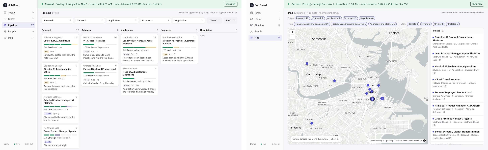

# Matt Fuchs

Building **[NextSession](https://getnextsession.com/)**, a training plan that adapts to your life.

I build AI products and agents, and I run them every day. Fifteen years on the business side of a $30B asset manager, finishing as the lead on its firm-wide AI rollout. In July 2026 I left to build full time.

---

## NextSession

**A training plan that adapts to your life.** When your week changes, NextSession rebuilds the plan around it and keeps you moving toward your goal.

Training plans assume a perfect week. Then life happens: a meeting runs over, a head cold, a 7am flight. NextSession is a plan that rebalances around your real week. Set the goal and the time you have, and it puts structured sessions on your calendar and your watch, rebuilds the week when something changes, and tells you how each workout went and what it means for the next one. For anyone training toward a goal, from a first 5K to a triathlon.

**[getnextsession.com](https://getnextsession.com/)** · **[Try the live demo](https://getnextsession.com/app/?event=half)** (no sign-in) · **[Get early access](https://getnextsession.com/join/)**

- **You say what changed.** "I'm travelling Tuesday" becomes a rebalanced week, with what the change costs shown before anything moves.
- **Does the admin.** Every session lands on your calendar and your Garmin or Wahoo as a structured workout with targets.
- **Reads the morning.** HRV, sleep and training load against your own usual decide whether today stands as written.
- **Talk to it where you already are.** In the app, or from Claude, ChatGPT or Grok through an MCP server, with undo.
- **Gets better over time.** It learns how your body responds and how you like to be coached.

**Your goal. Your week. Your plan.** Built end to end: product, brand, a multi-model coach, a deterministic executor that checks and reads back every write, and eval suites calibrated on human labels. The source is private.

---

## Also featured: Job Search Board

A one-screen command center for a senior job search: a daily routine finds and scores roles, and every pipeline move, person and to-do lives in one record.

**[Live demo](https://demo.mattfuchs.dev/job-board/)** · **[Repo](https://github.com/mfuchs22/job-search-board)**

---

## Toolbox

AI-obsessed. I build with these tools every day, study how they work, and can't get enough of what's new. Lately: multimodal agents with voice, image and video generation.

**Claude Code · Codex · Grok · ElevenLabs · Runway · Gemini · Supabase · Vercel**

---

## Links

- **NextSession:** [getnextsession.com](https://getnextsession.com/)
- **Demos:** [demo.mattfuchs.dev](https://demo.mattfuchs.dev)
- **LinkedIn:** [mattefuchs](https://www.linkedin.com/in/mattefuchs)
