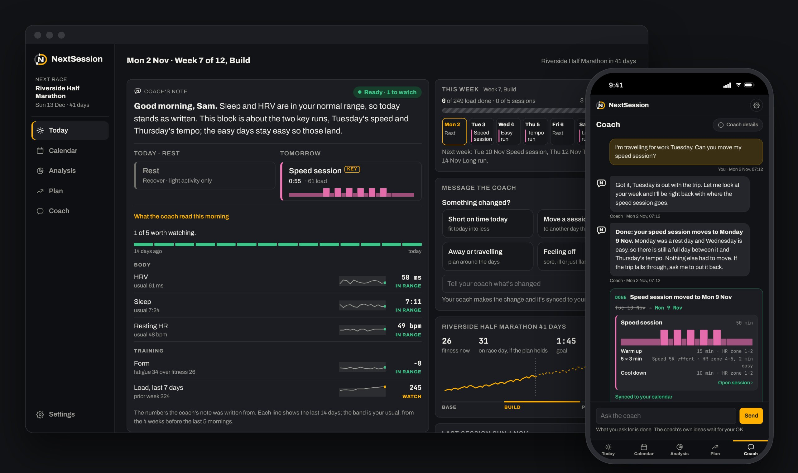

# Matt Fuchs

Building **[NextSession](https://getnextsession.com/welcome)**, an AI coach that rebuilds your training plan around your week.

I build AI products and agents, and I run them every day. Fifteen years on the business side of a $30B asset manager, finishing as the lead on its firm-wide AI rollout. In July 2026 I left to build full time.

---

## NextSession

**You do the workout. NextSession does everything else.**

Training plans assume a perfect week, and life moves it anyway: a work trip, a bad night, a meeting that runs over. NextSession is an AI coach that keeps up. Set the goal and the time you have, and it puts structured sessions on your calendar and your watch, reworks the week when something changes, and tells you how each workout went and what it means for the next one.

**[getnextsession.com](https://getnextsession.com/welcome)** · **[Try the live demo](https://getnextsession.com/?event=half)** (no sign-in) · **[Get early access](https://getnextsession.com/join.html)**

- **Replans in a sentence.** "I'm travelling Tuesday" becomes a reworked week, with what the change costs shown before anything moves.
- **Does the admin.** Every session lands on your calendar and your Garmin or Wahoo as a structured workout with targets.
- **Reads the morning.** HRV, sleep and training load against your own usual decide whether today stands as written.
- **Works with your AI assistant.** An MCP server lets Claude, ChatGPT or any MCP client read and change your plan, with undo.

Built end to end: product, brand, a multi-model coach, a deterministic executor that checks and reads back every write, and eval suites calibrated on human labels. The source is private.

---

## Also featured: Job Search Board

A one-screen command center for a senior, network-driven job search. A daily routine collects postings, a model scores each one against a rubric I keep correcting, and verdicts, pipeline moves, people and to-dos flow into one record that every view is generated from.

**[Live demo](https://demo.mattfuchs.dev/job-board/)** · **[Repo and build guide](https://github.com/mfuchs22/job-search-board)**

---

## What's running

| System | What it does |
|---|---|
| **Personal OS** | The repo every other agent reads: context, decisions, and a chief-of-staff router that sends plain-language requests to the right agent |
| **Media digest** | Turns what I watch and listen to into wiki pages and a morning digest |
| **Fantasy football agent** | Lineups and waivers, with moves made only once I approve |
| **Task board** | Phone and laptop view over my task database |
| **Bike garage** | Builds, parts and compatibility for a shared garage |
| **Home OS** | The house as a system, plus a 3D property model (in progress) |

## How I run

- **Heavy Claude Code**
- **Heavy Codex**
- **Heavy Grok**
- **Exploring multimodal agents:** voice, image generation and video generation

Deterministic code wherever the answer must be exact, a model only where judgment is needed, and a human approves anything that reaches another person.

## Elsewhere

- NextSession: [getnextsession.com](https://getnextsession.com/welcome)
- Demos: [demo.mattfuchs.dev](https://demo.mattfuchs.dev)
- LinkedIn: [matt-fuchs-cfa](https://www.linkedin.com/in/matt-fuchs-cfa)
